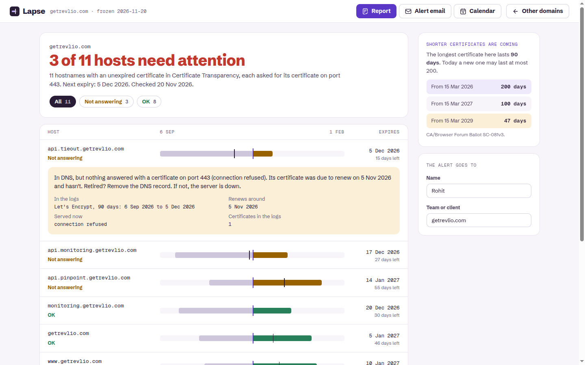
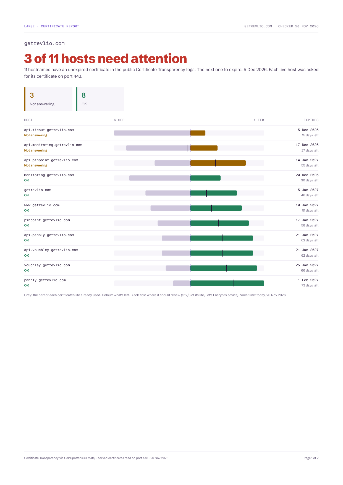
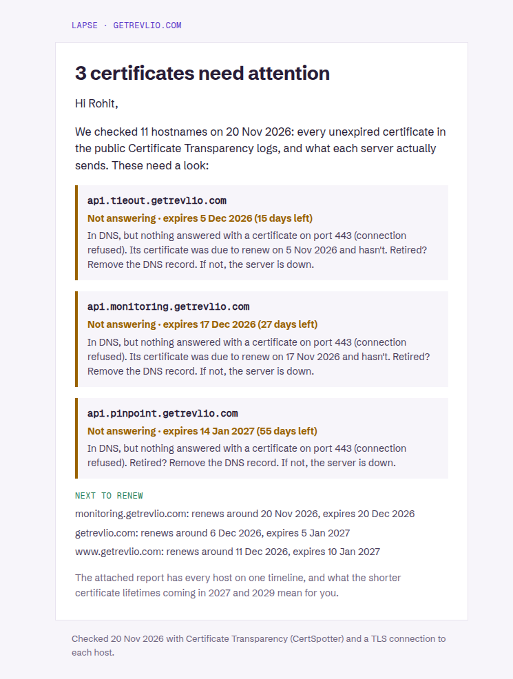
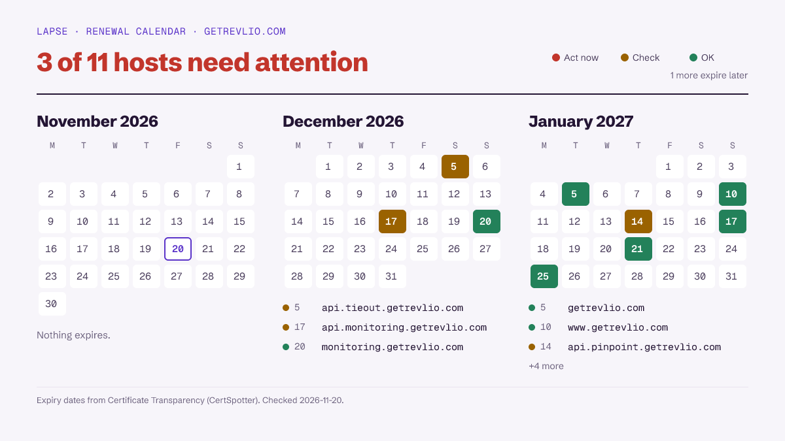

# Lapse

**Every certificate on your domain, and the ones that won't renew.** Type a domain. Lapse finds every subdomain with
a certificate in the public Certificate Transparency logs, asks each host what it really serves on port 443, and
tells you which renewals are stuck, which never got deployed, and which hosts stopped answering. Then it writes:

- a certificate report (PDF): every host as a time-left bar on one timeline, what needs attention, what 2027 changes
- an alert email for whoever fixes it
- a renewal calendar (PNG) for the team channel

Built with [Hyper Elements](https://github.com/hyper-elements/hyper-elements) for the Hyper Elements Template Challenge.



## Why this exists

Let's Encrypt, [22 January 2025](https://letsencrypt.org/2025/01/22/ending-expiration-emails):

> We will be ending this service on June 4, 2025… For those who would like to continue receiving expiration
> notifications, we recommend using a third party service.

And certificates keep getting shorter. The CA/Browser Forum's
[Ballot SC-081v3](https://cabforum.org/2025/04/11/ballot-sc081v3-introduce-schedule-of-reducing-validity-and-data-reuse-periods/)
(Apple, Google, Microsoft and Mozilla voted yes) sets the longest a public TLS certificate may last:

| Issued | Longest |
|---|---|
| before 15 Mar 2026 | 398 days |
| from 15 Mar 2026 | 200 days |
| from 15 Mar 2027 | 100 days |
| from 15 Mar 2029 | 47 days |

Renewal is automated for most people, and automation fails quietly: a DNS-challenge key expires, a server isn't
reloaded after renewal, a host is retired but its DNS record stays. On r/sysadmin
([February 2025](https://old.reddit.com/r/sysadmin/comments/1ii6qlm/)): "We monitor all our certificates, including LE
certs, to ensure that they are renewing properly before expiration. Every shop I've worked for has done this in one
way or another." Paid monitors exist (TrackSSL: $17–$136 a month).

**A real example: getrevlio.com, 20 Nov 2026** (the author's own domain). 15 unexpired certificates over 11 hostnames,
all Let's Encrypt:

| Host | Verdict | Why |
|---|---|---|
| api.tieout.getrevlio.com | Not answering | Due to renew on 5 Nov and hasn't; connection refused on 443 |
| api.monitoring.getrevlio.com | Not answering | Due to renew on 17 Nov; connection refused |
| api.pinpoint.getrevlio.com | Not answering | Valid until 14 Jan 2027; connection refused |
| 8 others | OK | Each serves the newest certificate in the logs |

## How it works

| Step | What happens |
|---|---|
| **Type the domains** | Up to five. The browser asks SSLMate's [CertSpotter](https://sslmate.com/help/reference/ct_search_api_v1) for every unexpired certificate of the domain and its subdomains (CORS-enabled; an optional API key raises the hourly limit and stays in the browser). |
| **Every host is asked** | `POST /api/served` opens a TLS connection (SNI = the host) to each public hostname and reads the certificate it sends: dates, issuer, SHA-256, names. It resolves the name first and refuses private, loopback and link-local addresses. |
| **Read the verdicts** | Each certificate as a time-left bar on one shared timeline, worst first; click a host for the reason, the logged certificate and the served one. |
| **Send the paperwork** | Preview and download the report, the alert email and the calendar. |

The verdicts (`templates/_shared/certs.ts`):

- **Renewed, not deployed:** the logs hold a certificate at least a week newer than the one served, and the served
  one is past its renewal point. (CDNs often hold several certificates issued the same day, from more than one CA;
  that's fine, and the dates shown are the served certificate's when the logs contain it.)
- **Renewal overdue / due:** past the renewal point with no newer certificate. The renewal point is Let's Encrypt's
  advice, "renewing 90 day certificates every 60 days and six day certificates every three days": 2/3 of the
  certificate's life (half for very short ones). Overdue = a week past it, or a week or less left.
- **Wrong certificate, expired:** what the server sends doesn't match the name, or has ended.
- **Not answering / retired:** in DNS but nothing on port 443, or no DNS record any more.

| Report, page 1 | Alert email | Calendar |
|---|---|---|
|  |  |  |

Report page 2 (what needs attention, shorter certificates): [media/report-page-2.png](media/report-page-2.png). The
landing page (7 sections with an FAQ): [media/landing.png](media/landing.png). On a phone:
[media/mobile.png](media/mobile.png). The sample report: [public/landing/getrevlio-report.pdf](public/landing/getrevlio-report.pdf).

## How Hyper Elements is used

The three outputs are **Hyper Elements templates** in `templates/`. The app renders them in a route handler
(`src/app/api/render/route.ts`), and the CLI renders the same files.

- **Typed fields with rules** (`templates/_shared/doc.tsx`): a host must look like a hostname, its state is one of
  eight `prop.choice` values, a lifetime is 1–398 days, at most 40 hosts with the real total as its own field. Values
  outside the rules stop the render with the field and the reason (the API answers 422).
- **`<Document>` + `renderPdf()`** for the report: one `Svg` time-left bar per host (used life, life left in the
  state's colour, a renewal tick, today's line) on a window shared by every row, the verdict cards, and the SC-081
  steps. Pages are planned from measured row and card heights, because a Document page doesn't flow onto the next
  one by itself; a 40-host stress test renders 6 clean pages.
- **`<Email>`** for the alert, with lint (`lang`, `contrast`, `link-text`), the email client checks and preview text
  required.
- **`<Canvas>` + `renderImage()`** for the 1200 × 675 calendar: three month grids built from `Row`s and `Column`s,
  expiry days filled with the state's colour, with `image/overflow`, `image/glyph` and `image/fit` required. The
  layout check caught day numbers 4 px too wide for a ringed cell while we built it.
- **Values files + CLI:** `npm run reports` turns `docs/getrevlio.json` into values files with
  `hyper-elements design new`, then renders all three with `hyper-elements render`.

## Run it

Needs Node 22.6+.

```bash
npm install
npm run dev            # http://localhost:3000 (landing) and /check (the dashboard)
```

```bash
npm test               # SC-081 dates, every verdict, CDN certificates, domain cleanup, private addresses, the sample (6 tests)
npm run check          # check the three templates with their example
npm run reports        # docs/getrevlio.json → out/docs/ (report PDF, alert email, calendar PNG)
npm run sample         # re-read getrevlio.com live and rebuild the sample
npm run preview:email  # the email as each email client draws it
npm run build && npm start
```

The `/api/served` route needs a Node server (it uses `node:tls`).

## Project layout

```
templates/_shared/certs.ts    CertSpotter parsing, SC-081 dates, the renewal point, the verdicts (no imports)
templates/_shared/doc.tsx     fields, the instrument look, the time-left bar
templates/_shared/example.ts  the sample: getrevlio.com on 20 Nov 2026 (generated by scripts/sample.ts)
templates/report.tsx          <Document>: the certificate report
templates/alert.tsx           <Email>: the alert
templates/calendar.tsx        <Canvas>: the renewal calendar
src/lib/load.ts               CertSpotter from the browser, then /api/served; the frozen sample
src/lib/served.ts             reading a host's certificate with node:tls, private-address guard
src/components/Panel.tsx      the dashboard
src/app/page.tsx              the landing page
public/samples/               getrevlio.com's CertSpotter answer and served certificates, 20 Nov 2026
tests/                        certificate tests
```

## Sample data

`public/samples/getrevlio.json` is CertSpotter's answer for getrevlio.com and what each host served on 20 November
2026. The domain belongs to this series' author. Certificate Transparency data is public. Lapse is not affiliated
with Let's Encrypt, SSLMate or the CA/Browser Forum.

## License

MIT for the code. Fonts: Schibsted Grotesk and Geist Mono, SIL Open Font License 1.1 (`fonts/OFL-*.txt`).
